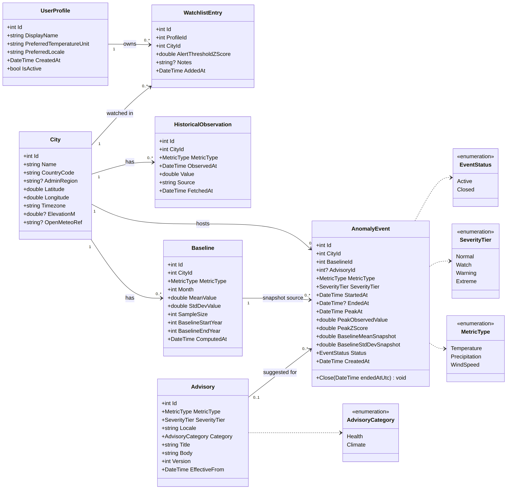
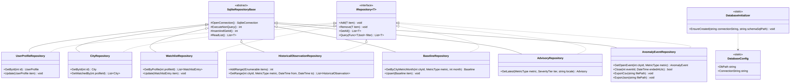
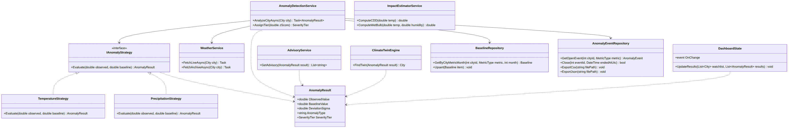

# ClimaPulse

**See how unusual today's weather is, not just how hot it is.**

A weather app tells you "35 °C". It does not tell you whether 35 °C is normal for that city in that month, and that is where the risk is.
ClimaPulse is a Windows desktop app that compares today's weather in your cities with their own 30-year history (1995 to 2024),
measures how far from normal it is (a z-score), and turns that into a plain tier: **Normal, Watch, Warning or Extreme**,
with health and climate advice for that tier. Every anomaly episode is kept in a ledger you can filter and export.

> Junior Project 2026, DTETI, Universitas Gadjah Mada. Group **Mendoan**.
> C# desktop app: WPF on .NET 10, PostgreSQL. Weather data from [Open-Meteo](https://open-meteo.com) (CC BY 4.0).
> ClimaPulse shows statistical anomalies. It is not an official BMKG warning.

## Team

| Name | Student ID | Role |
| --- | --- | --- |
| Nalen Raditya Sadewa | 536801 | Group leader, project manager, software engineer (backend) |
| Arya Raditya Ardana | 536660 | UI/UX designer |
| Christania Putri Rachmadewi | 532874 | Frontend developer (WPF) |
| Muhammad Ibrahim Asy Syauqi Wahyuaji | 5327610 | Backend developer |

## Screenshots

Screenshots of the release build go in `docs/screenshots/` together with the first GitHub Release. The screen designs (Figma "Junpro", Set A) are S1 Profile picker, S2 Add city, S3 Dashboard, S4 City detail, S5 Anomaly ledger and S6 Settings.

## Try it (for lecturers)

**About 10 minutes.** You need Windows 10 or 11 (64-bit) and PostgreSQL.

1. Install [PostgreSQL](https://www.postgresql.org/download/windows/) and keep the service running. Create the database once:
   ```powershell
   createdb -U postgres climapulse
   ```
2. Tell ClimaPulse how to connect (use your own port and password):
   ```powershell
   setx CLIMAPULSE_DB_CONNECTION "Host=localhost;Port=5432;Database=climapulse;Username=postgres;Password=YOUR_PASSWORD"
   ```
3. Get the app:
   - **Demo build:** download `ClimaPulse-win-x64.zip` from [GitHub Releases](https://github.com/Rdiit6/Junior-Project/releases), unzip it and double-click `ClimaPulse.Desktop.exe`. It is self-contained, so no .NET install is needed.
   - **From source:** see [Run it locally](#run-it-locally).
4. Start the app once (it creates the tables), close it, and load the sample data and advice texts:
   ```powershell
   psql -U postgres -d climapulse -f backend\Database\seed.sql
   ```
5. Walk through it:
   1. Pick the profile **Radit** (or create your own).
   2. **Add city**, search "Yogyakarta" or any city. ClimaPulse downloads 30 years of daily history once and shows the progress.
   3. Press **Refresh all**. Each city gets a tier badge (colour, icon and word) with today's value and z-score.
   4. Open a city: today against the 30-year normal, the bell curve, the last 14 days, and the advice.
   5. Open **Anomaly Ledger**: filter by city, metric, tier, status and dates, then **Export CSV** or **Export JSON**.
   6. In **Settings**, switch °C and °F, or refresh the baselines.

On an ordinary weather day every city shows **Normal**, which is the correct answer. Anomalies are rare by design.

## What you can do

| You want to | ClimaPulse gives you | Requirement |
| --- | --- | --- |
| Follow several cities | Search any city in the world and keep your own watchlist per profile, with an alert threshold and a note per city | FR-01 to FR-04 |
| Know if today is unusual | A tier per metric (temperature, rain, wind) from the z-score against that city's normal for this month | FR-10 to FR-14, FR-17 |
| Understand why | Today's value, the 30-year mean and standard deviation, the z-score, a bell curve and the last 14 days | FR-20 |
| Know what to do | Health and climate advice for the active tier | FR-19 |
| Look back | A ledger of every anomaly episode (start, peak, end), filtered, paged and exported as CSV or JSON | FR-22 to FR-28 |
| Use your units | Celsius or Fahrenheit per profile | FR-05 |
| Share one PC | Several local profiles, no password needed | FR-29 |

| Tier | z-score (absolute) | Shown as |
| --- | --- | --- |
| Normal | below 2.0 | green badge, no advice |
| Watch | from 2.0 | yellow badge with an icon and the word "Watch" |
| Warning | from 3.0 | orange badge with an icon and the word "Warning" |
| Extreme | from 4.0 | red badge with an icon and the word "Extreme" |

An anomaly episode opens at |z| ≥ 2.0 and closes when |z| drops below 1.75, so a reading that hovers near the limit does not open and close events again and again.

## Who it is for

| Who | Their problem | What they use |
| --- | --- | --- |
| People and families | "35 °C" says nothing about whether today is dangerous where they live | The dashboard badge and the health advice |
| Outdoor workers, farmers, event organisers | They need to know early when heat, rain or wind is far from normal | Refresh all, the tier per metric, the climate advice |
| Students and researchers | No clean record of when and how strongly a city's weather was abnormal | The anomaly ledger with filters and CSV or JSON export |
| Anyone following several places | Home, campus and family live in different climates | A watchlist where each city is judged against its own normal |

## Why choose these

| Choice | Why | Where |
| --- | --- | --- |
| A z-score against each city's own normal | 35 °C is normal in Surabaya and extreme in Tokyo. One fixed limit for every city would be wrong almost everywhere | `backend/Strategies/ZScoreCalculator.cs` |
| A baseline per city, metric and calendar month (1995 to 2024) | The normal for November is not the normal for June. 30 years is the usual length of a climate normal | `backend/Services/BaselineService.cs` |
| Today's daily value against daily history | Comparing the 14:00 reading with whole-day averages would make every afternoon look hot | `backend/Services/WeatherService.cs` |
| One strategy class per metric | Temperature, rain and wind are judged through the same `IAnomalyStrategy` interface, so a new metric is a new class, not an edit (polymorphism) | `backend/Strategies/` |
| Episodes with hysteresis, not one row per reading | Ten anomalous readings in a row are one event, and the ledger stays readable | `AnomalyDetectionService.DecideEvent` |
| Baseline snapshots on every event | Recomputing a baseline never changes the history | `AnomalyEvent` table |
| Frontend and backend meet in C# interfaces | A renamed field breaks the build instead of the demo | `shared/ClimaPulse.Contracts` |
| WPF, PostgreSQL and Open-Meteo | WPF is a C# desktop UI allowed by Module 1. PostgreSQL enforces the data rules. Open-Meteo gives free forecasts and 30-year archives with no API key | `frontend/`, `backend/Database/schema.sql` |

## How a reading is judged

```
 Add city ──▶ Open-Meteo archive: 30 years of daily values ──▶ HistoricalObservation
                                                                  │
                                       mean and standard deviation per month ──▶ Baseline
 Refresh ──▶ Open-Meteo forecast: today's daily value               │
                       │                                            │
                       └──────────── z = (today - mean) / std dev ◀─┘
                                            │
                 tier: Normal · Watch · Warning · Extreme ──▶ badge + advice
                                            │
                 open, update or close an episode ──▶ AnomalyEvent (the ledger)
```

1. **Add a city.** ClimaPulse finds it with Open-Meteo geocoding and downloads its daily temperature, rain and wind for 1995 to 2024, once.
2. **Baselines.** For each metric and calendar month it stores the mean, the standard deviation and the number of days.
3. **Refresh.** It fetches today's daily value in the city's own time zone and computes the z-score for each metric. A standard deviation of 0 is shown as "not enough variation", never as a fake Normal.
4. **Tier and advice.** The z-score becomes a tier, and the matching health and climate advice is shown.
5. **Ledger.** If |z| reaches 2.0 an episode opens; worse readings raise its peak; it closes below 1.75.

## Module 1: requirements and where to find them

| Module 1 asks for | Weight | Where it is |
| --- | --- | --- |
| A C# desktop application | required | WPF on .NET 10 in `frontend/`, backend class library in `backend/` |
| Documentation on GitHub, with Git | 20% (product) | This README, `docs/`, pull requests into `Development` with a template and CI |
| Demo access information and brief usage documentation | (in the 20%) | [Try it (for lecturers)](#try-it-for-lecturers), GitHub Releases, the GitHub Page from `docs` on `main` |
| The demo runs without errors | 20% (product) | CI builds and tests every pull request. A crash handler keeps the app open and logs to `%LOCALAPPDATA%\ClimaPulse\logs` |
| OOP design quality, originality and usefulness | 20% (product) | [Why choose these](#why-choose-these), [class diagrams](#class-diagrams-module-3), `backend/Strategies/` |
| Teamwork, design principles, aligned deliverables, quizzes | 40% (process) | [Team](#team), `docs/team-tasks.md`, `docs/SRD.md`, `docs/api-contract.md`, pull request history |
| README with the group members | required | [Team](#team) |

## Where it is in the code

| Claim | Code | Tests |
| --- | --- | --- |
| z-score and tiers | `backend/Strategies/`, `backend/Services/AnomalyDetectionService.cs` | `AnomalyDetectionServiceTests`, `WindStrategyTests` |
| Episodes with hysteresis | `AnomalyDetectionService.DecideEvent` | `HysteresisTests` |
| Monthly baselines from 30 years | `backend/Services/BaselineService.cs` | `BaselineServiceTests` |
| Live refresh and the last 14 days | `backend/Services/MonitoringService.cs` | `MonitoringServiceTests` |
| Open-Meteo search, forecast and archive | `backend/Services/WeatherService.cs` | `WeatherServiceTests` |
| Dashboard, worst first | `backend/Services/DashboardService.cs` | `DashboardServiceTests` |
| Ledger: filters, paging, CSV and JSON export | `backend/Services/EventLedgerService.cs` | `EventLedgerServiceTests` |
| Profiles, cities, watchlist | `ProfileService`, `CityService`, `WatchlistService` | `ProfileServiceTests`, `CityServiceTests`, `WatchlistServiceTests` |
| Database rules | `backend/Database/schema.sql`, `backend/Repositories/` | `RepositoryDatabaseTests` |
| The contract between UI and logic | `shared/ClimaPulse.Contracts` | compiler |
| Screens and the composition root | `frontend/Page/`, `frontend/App.xaml.cs` | manual and black-box testing |

## Class diagrams (Module 3)

The class diagrams match the 7-table database (UserProfile, City, Watchlist, HistoricalObservation, Baseline, Advisory, AnomalyEvent). Mermaid sources are in `docs/class-diagram/`.

**1. Domain model and enums**



**2. Data access layer**



**3. Services and strategies**



<details><summary>Previous version (before the database alignment)</summary>


</details>

## Documentation

| Document | What it is |
| --- | --- |
| [`docs/SRD.md`](docs/SRD.md) | Requirements, constraints, grading criteria and decisions |
| [`docs/api-contract.md`](docs/api-contract.md) | The contract between frontend and backend, and the Open-Meteo details |
| [`docs/references-desktop-architecture.md`](docs/references-desktop-architecture.md) | Architecture, project setup and pitfalls |
| [`docs/design-references.md`](docs/design-references.md) | Screens, colours and accessibility |
| [`docs/team-tasks.md`](docs/team-tasks.md) | Who does what |
| [`docs/github-ai-agent-rules.md`](docs/github-ai-agent-rules.md) | Git and AI tool rules for the team |

## What comes next

- Indonesian language: move the screen texts into resource files (`.resx`) and add `id-ID` advice.
- A background refresh timer, within Open-Meteo's free limits.
- A "climate twin": the city whose normal climate matches today's anomaly.
- Impact estimates such as cooling degree days and wet-bulb temperature.

## Run it locally

Needs Windows 10 or 11, the [.NET 10 SDK](https://dotnet.microsoft.com/download) and PostgreSQL. Visual Studio 2022 or newer with ".NET desktop development" is optional.

```powershell
dotnet build ClimaPulse.slnx
dotnet test ClimaPulse.slnx --filter "Category!=Database"   # unit tests, no database needed
dotnet run --project frontend\ClimaPulse.Desktop.csproj
```

- The app reads the connection string from `CLIMAPULSE_DB_CONNECTION` (see `backend/.env.example`). .NET does not read `.env` files, so set it as a Windows environment variable. Never commit a real password.
- The database tests (`Category=Database`) need a separate database whose name ends in `_test`, set in `CLIMAPULSE_TEST_DB_CONNECTION`. They empty that database on every run.
- Demo build: `dotnet publish frontend -c Release -r win-x64 --self-contained true -o publish/ClimaPulse`, then zip `publish/ClimaPulse`.

## Repo layout

| Path | What |
| --- | --- |
| `frontend/` | ClimaPulse.Desktop: the WPF app (windows, user controls, charts drawn by hand) |
| `backend/` | ClimaPulse.Backend: services, strategies, repositories, Open-Meteo client |
| `backend/Database/` | `schema.sql`, `seed.sql`, `schema.dbml` |
| `shared/ClimaPulse.Contracts/` | Interfaces, DTOs, enums and exceptions shared by both sides |
| `tests/ClimaPulse.Backend.Tests/` | xUnit tests: unit tests and database tests |
| `docs/` | SRD, API contract, architecture, design references, class diagrams |
| `.github/workflows/ci.yml` | CI: build with warnings as errors, all tests with PostgreSQL, schema and seed load |

## Data and credits

Weather data by [Open-Meteo.com](https://open-meteo.com), licensed under [CC BY 4.0](https://creativecommons.org/licenses/by/4.0/). Used for non-commercial, educational purposes within Open-Meteo's free limits.
