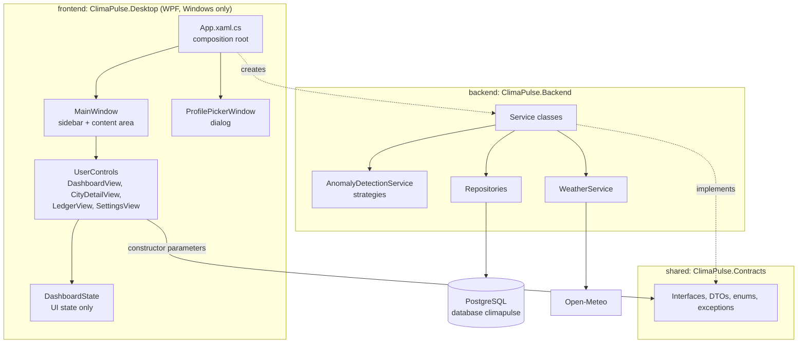

# ClimaPulse: Desktop Architecture and References

Status: draft for team review. Last updated 2026-11-25. The UI is WPF (accepted 2026-11-25, replacing Windows Forms; Blazor and Razor are not used). Replaces `references-web-and-api.md` (the web and HTTP API design).

This file explains how ClimaPulse is built as a desktop app, how to set up the projects, and where to read more. The database schema (`backend/Database/schema.sql`) and the repositories are already done. The contract between frontend and backend is in `docs/api-contract.md`.

**Link status.** *Verified* means the page was opened or appeared in a live web search on the date shown. *Check* means it is a well-known official page I could not confirm from my environment, so open it once before relying on it.

---

## 1. Decisions

| Topic | Decision | Decided by |
|---|---|---|
| Platform | Windows desktop app, required by Module 1 ("C# desktop application: Windows Store, Windows Forms or WPF") | Module 1 |
| UI technology | WPF. The main window is a `Window`, screens are `UserControl`s in XAML, dialogs are small `Window`s opened with `ShowDialog()`. No Blazor, no Razor | Nalen (project manager), 2026-11-25 (was Windows Forms, 2026-11-16) |
| Frontend to backend | In-process C# interfaces in `shared/ClimaPulse.Contracts`. No HTTP API | Radit, 2026-10-22 |
| Users | No login. Profile picker on start | Radit, 2026-10-22 |
| Framework | .NET 10 LTS | Radit, 2026-10-16 |
| Database | PostgreSQL through `Npgsql`, existing ADO.NET repositories | Modul 4, changed 2026-11-16 |
| Repo layout | Monorepo: `frontend/`, `backend/`, `shared/` | Radit |
| Weather data | Open-Meteo forecast and archive APIs | PRD |
| Team machines | Everyone develops on Windows | Radit, 2026-10-22 |

### Why these choices, and what they cost

**A. WPF**
- Why: allowed by Module 1. Windows Forms was the plan until 2026-11-25; the screens were then built in WPF against the same contract, so the team kept WPF instead of rewriting them.
- Pros: XAML styles and templates make the Figma look (rounded cards, badges, chips) much easier than Windows Forms. Sharp at any display scaling. Built-in `DataGrid`, `SaveFileDialog` (`Microsoft.Win32`) and keyboard focus handling. No WebView2 runtime needed.
- Cons: more to learn than Windows Forms (XAML, layout panels). No built-in chart control on .NET 10, so charts are drawn by hand (see 1E). XAML files merge badly when two people edit the same screen.

**B. In-process services instead of an HTTP API**
- Pros: one program, one F5, nothing to start first. No ports, CORS or network errors between UI and logic, which protects the "demo runs without errors" grade (20 percent). The contract is checked by the compiler.
- Cons: a future web or mobile client would need an HTTP layer added on top of the same interfaces.

**C. Target frameworks**
- `shared/ClimaPulse.Contracts` and `backend`: `net10.0`. Their unit tests also run on Mac, Linux or a CI server.
- `frontend`: `net10.0-windows` with `<UseWPF>true</UseWPF>`.
- Background: Microsoft's notice says .NET 8 and 9 stop being supported on 2026-11-10, which is why the project uses .NET 10.

**D. Keep the existing ADO.NET repositories**
- Pros: already written. Cons: SQL is hand-written, so a column change touches two places. Revisit Entity Framework Core only if the schema changes a lot.

**E. Charts (SRD OPEN-9)**
- WPF on .NET 10 has no built-in chart control.
- **Decided 2026-11-21: draw by hand, no library.** One small `UserControl` per chart (`BellCurveChart`, `TrendChart`) that overrides `OnRender` and draws with `DrawingContext` (`DrawLine`, `DrawGeometry`, `DrawRectangle`, `DrawText`). Call `InvalidateVisual()` when the data changes.
- Bell curve: plot the normal curve from -4σ to +4σ, a line at the mean, and a marker at today's z-score (clamp to ±4.5 so it stays on screen).
- 14-day chart: a shaded band for mean ± 2σ, a line for the daily values, a dot for today. Scale values to pixels from the min and max of the data and the band.
- Pros: no package, full control over the Figma look. Cons: no zoom or tooltips; add a one-sentence text summary under each chart instead.

**F. No dependency injection package**
- `App.xaml.cs` builds the objects by hand and passes interfaces into each window's constructor. For one window and about ten services this is shorter than `Microsoft.Extensions.DependencyInjection` and needs no extra package.

---

## 2. Architecture



Layering rules:
1. Windows and user controls receive only `ClimaPulse.Contracts` interfaces, through their constructors. Never a repository, `WeatherService` or another backend class.
2. Only `frontend/App.xaml.cs` (the composition root) knows the backend classes, to create them.
3. Services return DTOs, never `ClimaPulse.Models` entities.
4. Only `WeatherService` calls Open-Meteo.
5. Tier and z-score logic lives only in the backend. Screens only display it.

Screens (as built on `feat/fe`; views are `UserControl`s shown in `MainWindow`, dialogs are `Window`s):

| Screen | Built from | SRD |
|---|---|---|
| `ProfilePickerWindow`, `NewProfileWindow`, `FirstCityWindow` (dialogs on start) | profile list, name `TextBox`, first-city search | FR-29, FR-01 |
| `DashboardView` | `CityCard` and `TierBadge` controls (colour + icon + text), metric filter, Refresh all, last-updated text | FR-17, FR-18, FR-19 |
| `AddCityWindow` (dialog) | search `TextBox`, results list, import progress | FR-01, FR-02, FR-07 |
| `CityDetailView`, `RemoveCityWindow` | reading, baseline mean and SD, z-score, `BellCurveChart`, `TrendChart`, advice, threshold, past events | FR-03, FR-04, FR-19, FR-20 |
| `LedgerView` | filter `ComboBox`es and dates, paged `DataGrid`, event drawer, Export with `SaveFileDialog` | FR-26, FR-27 |
| `SettingsView` | unit, default threshold, profile name, refresh baselines | FR-04, FR-05, FR-09 |

---

## 3. Setup guide

Do these on a feature branch. You need Windows, the .NET 10 SDK (`dotnet --version` prints `10.x`), Visual Studio 2022 or newer with the ".NET desktop development" workload (for the XAML designer), and a local PostgreSQL server.

### Step 1: Create the projects

```bash
# from the repo root, on a fresh branch
dotnet new classlib -n ClimaPulse.Contracts -o shared/ClimaPulse.Contracts
dotnet new classlib -n ClimaPulse.Backend   -o backend
dotnet new wpf      -n ClimaPulse.Desktop   -o frontend
dotnet new xunit    -n ClimaPulse.Backend.Tests -o tests/ClimaPulse.Backend.Tests
dotnet new sln -n ClimaPulse
dotnet sln add shared/ClimaPulse.Contracts backend frontend tests/ClimaPulse.Backend.Tests
dotnet add backend  reference shared/ClimaPulse.Contracts
dotnet add frontend reference shared/ClimaPulse.Contracts backend
dotnet add tests/ClimaPulse.Backend.Tests reference backend
dotnet add backend  package Npgsql
```

Pitfalls:
- `dotnet new` writes `Class1.cs`, `App.xaml` and `MainWindow.xaml` into folders that already hold code. Check `git status` afterwards, keep one `App.xaml.cs` as the composition root (step 3), and delete the generated `Class1.cs` files.
- The leftover Blazor file `frontend/Components/Dashboard.razor` was deleted on 2026-11-21. The frontend contains only C# and XAML (WPF).
- Move `backend/Enums/*.cs` into `shared/ClimaPulse.Contracts/Enums/`, keeping the namespace `ClimaPulse.Enums`, so the UI can use them without referencing the backend. This is a file move, so agree on it first.
- Each package needs team approval before it is added (AGENTS.md).

### Step 2: The Desktop project file

`frontend/ClimaPulse.Desktop.csproj` (the template already writes most of this):

```xml
<Project Sdk="Microsoft.NET.Sdk">
  <PropertyGroup>
    <OutputType>WinExe</OutputType>
    <TargetFramework>net10.0-windows</TargetFramework>
    <UseWPF>true</UseWPF>
    <Nullable>enable</Nullable>
    <ImplicitUsings>enable</ImplicitUsings>
    <RootNamespace>ClimaPulse.Desktop</RootNamespace>
  </PropertyGroup>
  <ItemGroup>
    <Content Include="..\backend\Database\schema.sql" Link="Database\schema.sql" CopyToOutputDirectory="PreserveNewest" />
  </ItemGroup>
</Project>
```

### Step 3: The composition root

`frontend/App.xaml.cs` is the only place where frontend code names backend classes. Sketch (all 8 services are created here):

```csharp
public partial class App : Application
{
    protected override async void OnStartup(StartupEventArgs e)
    {
        base.OnStartup(e);
        DispatcherUnhandledException += (_, args) => { ShowError(args.Exception); args.Handled = true; };
        AppDomain.CurrentDomain.UnhandledException += (_, args) => Log((Exception)args.ExceptionObject);

        var connectionString = DatabaseConfig.ConnectionString;
        DatabaseInitializer.EnsureCreated(connectionString,
            Path.Combine(AppContext.BaseDirectory, "Database", "schema.sql"));

        // Repositories are stateless and open a connection per call, so one instance each is enough.
        var cities = new CityRepository(connectionString);
        // ... the other six repositories

        // Open-Meteo: one shared HttpClient with a timeout.
        var weather = new WeatherService(new HttpClient { Timeout = TimeSpan.FromSeconds(20) }, new OpenMeteoOptions());
        var state = new CityRefreshState();   // shared by baseline, monitoring and dashboard

        IDashboardService dashboard = new DashboardService(/* repositories */, state);
        // ... one service per interface (8 in total)

        var picker = new ProfilePickerWindow(/* interfaces */);
        if (picker.ShowDialog() == true)
            new MainWindow(/* profile and interfaces */).Show();
    }
}
```

Why each piece exists:
- `DispatcherUnhandledException` catches errors raised on the UI thread (button clicks, `async void` handlers); `args.Handled = true` keeps the app running (contract section 7). `UnhandledException` covers other threads, but it can only log: the process still ends afterwards.
- `EnsureCreated` creates the tables on a new PC; the `Content` item in step 2 copies `schema.sql` next to the `.exe`.
- A single shared `HttpClient` is the simple, correct choice for one desktop process.
- Windows and user controls get their services through constructors, and still call `InitializeComponent()` first.

### Step 4: Calling services from a window

```csharp
private async void RefreshButton_Click(object sender, RoutedEventArgs e)
{
    RefreshButton.IsEnabled = false;
    try
    {
        var result = await _dashboard.GetAsync(_profileId);   // set after the profile picker closes
        ShowCities(result);
    }
    catch (ClimaPulseException ex)
    {
        MessageBox.Show(ex.Message, "ClimaPulse", MessageBoxButton.OK, MessageBoxImage.Warning);
    }
    finally
    {
        RefreshButton.IsEnabled = true;
    }
}
```

- `async void` is correct only for event handlers. `await` returns to the UI thread, so controls can be updated directly afterwards.
- Never call `.Result` or `.Wait()` in a window or user control; it freezes or deadlocks the window.
- For progress (baseline refresh), pass a `Progress<int>` created on the UI thread and set a `ProgressBar` in its callback.

### Step 5: Database and configuration

- Install PostgreSQL on the PC and create the database once with `createdb climapulse`. `DatabaseConfig` reads the connection string from `CLIMAPULSE_DB_CONNECTION` and falls back to `Host=localhost;Port=5432;Database=climapulse;Username=postgres`. `DatabaseInitializer` creates the tables on first start.
- .NET does not read `.env` files. `backend/.env.example` only documents the variable names. Set the variable in the Visual Studio launch profile or in Windows environment variables.
- Settings that are not in the database (last profile, theme) go in `%LOCALAPPDATA%\ClimaPulse\settings.json` (contract decision C3).

### Step 6: Test

- Unit tests (xUnit): `AnomalyDetectionService`, strategies, z-score and tier rules. No database, no network.
- Service tests: each interface method against a separate test PostgreSQL database, checking DTO values and exception types.
- Manual demo path: pick profile, add city, refresh, see badge, open city detail, open ledger, export CSV. Run it on the demo laptop, not only on the developer's PC, and at 125 or 150 percent display scaling.

### Step 7: Publish a demo build

```bash
dotnet publish frontend -c Release -r win-x64 --self-contained true -o publish/ClimaPulse
```

Zip the `publish/ClimaPulse` folder and attach it to a GitHub Release. Module 1 grades "access information for a product demo", so link that release from the README together with short run instructions, including the PostgreSQL install and `createdb climapulse` step. A self-contained build runs on a PC without the .NET SDK.

---

## 4. Reference links

### Desktop and WPF

| Topic | Link | Status |
|---|---|---|
| WPF documentation home | https://learn.microsoft.com/dotnet/desktop/wpf/ | Check |
| Create a WPF app with Visual Studio | https://learn.microsoft.com/dotnet/desktop/wpf/get-started/create-app-visual-studio | Check |
| `DataGrid` control | https://learn.microsoft.com/dotnet/desktop/wpf/controls/datagrid | Check |
| `Application.DispatcherUnhandledException` | https://learn.microsoft.com/dotnet/api/system.windows.application.dispatcherunhandledexception | Check |
| .NET application publishing overview | https://learn.microsoft.com/dotnet/core/deploying/ | Verified 2026-10-22 |
| Single-file deployment | https://learn.microsoft.com/dotnet/core/deploying/single-file/overview | Verified 2026-10-22 |
| .NET 8 and 9 end of support notice | https://devblogs.microsoft.com/dotnet/dotnet-8-9-end-of-support/ | Verified 2026-10-16 |

### Database

| Topic | Link | Status |
|---|---|---|
| Npgsql documentation | https://www.npgsql.org/doc/ | Check |
| Npgsql on NuGet | https://www.nuget.org/packages/Npgsql | Check |

### Weather data

| Topic | Link | Status |
|---|---|---|
| Open-Meteo forecast API docs | https://open-meteo.com/en/docs | Verified 2026-10-22 (opened) |
| Open-Meteo historical (archive) API docs | https://open-meteo.com/en/docs/historical-weather-api | Verified 2026-10-22 (opened) |
| Open-Meteo geocoding API (city search, contract decision C2) | https://open-meteo.com/en/docs/geocoding-api | Verified 2026-10-22 (opened) |
| Open-Meteo terms | https://open-meteo.com/en/terms | Verified 2026-10-22 (opened) |

Confirmed on those pages on 2026-10-22: free use is non-commercial, under CC BY 4.0, limited to less than 600 calls per minute, 5,000 per hour, 10,000 per day and 300,000 per month per IP address. ERA5 and ERA5-Land archive data has about a 5-day delay. The endpoints, variables and units the backend uses are fixed in `docs/api-contract.md`, section 14. Cache every archive response in `HistoricalObservation` so a city is never downloaded twice.

### Charts (drawn by hand, SRD OPEN-9)

| Topic | Link | Status |
|---|---|---|
| `UIElement.OnRender` and `DrawingContext` | https://learn.microsoft.com/dotnet/api/system.windows.uielement.onrender | Check |

---

## 5. Known pitfalls

1. **Time zones.** The database stores UTC (`yyyy-MM-ddTHH:mm:ssZ`). Convert to the city's `timezone` only in the UI.
2. **Decimal separator.** Indonesian Windows writes `29,1`. Use `CultureInfo.InvariantCulture` for export files and for any number sent to Open-Meteo in a URL. Reading coordinates with the wrong culture silently sends a wrong place.
3. **Frozen window.** Windows and user controls run on the UI thread. `await` every service call in `async void` event handlers. Long database or calculation work goes into `Task.Run` in the backend. Never call `.Result` or `.Wait()` in a window or user control.
4. **Cross-thread control access.** Only touch controls from the UI thread. After `await` you are back on it; inside `Task.Run` you are not, so report through `IProgress<T>` instead.
5. **Month baselines.** One row per city, metric and calendar month, computed from about 30 years of data. Compute once, store, refresh with the existing upsert, and show progress.
6. **Duplicate ledger rows.** Open one `AnomalyEvent` when a reading crosses the threshold, keep it `active`, close it when readings return below the closing threshold (hysteresis, SRD OPEN-1).
7. **Snapshots.** Copy the baseline mean and standard deviation into the event when it opens. Never join back to `Baseline` to show an old event.
8. **Zero standard deviation.** `stddev_value` may be 0. Return `DataStatus.ZeroVariance` instead of dividing.
9. **Overlapping refreshes.** Do not run a baseline refresh and a live refresh for the same city at the same time. The contract makes the second call throw `ConflictException`. Disable the button while a call runs.
10. **Database server.** The app needs a running PostgreSQL server. Check it is installed and started on the demo laptop, and show a clear error when the connection fails.
11. **XAML conflicts.** Two people editing the same `.xaml` screen at once causes painful merge conflicts, so give each screen one owner.

---

## 6. Suggested build order

1. Create the solution and projects. `MainWindow` opens with an empty sidebar.
2. Contracts project: enums (moved), DTOs, interfaces, exceptions (copy from `docs/api-contract.md`).
3. Frontend: fakes for every interface, then `ProfilePickerWindow` and `DashboardView` against the fakes.
4. Backend in parallel: `IProfileService`, `ICityService`, `IWatchlistService` on the existing repositories, with service tests.
5. `WeatherService` live fetch, then archive fetch and `IBaselineService`.
6. `AnomalyDetectionService`, the temperature strategy, event logging, `IMonitoringService` and `IDashboardService`.
7. Switch `UseFakes` off. `LedgerView` with CSV and JSON export.
8. Publish the demo build and run the demo path on the demo laptop.
9. Precipitation and wind strategies, twin cities and impact estimates if time remains.

Requirements and open decisions are in `docs/SRD.md`. The contract is in `docs/api-contract.md`.
