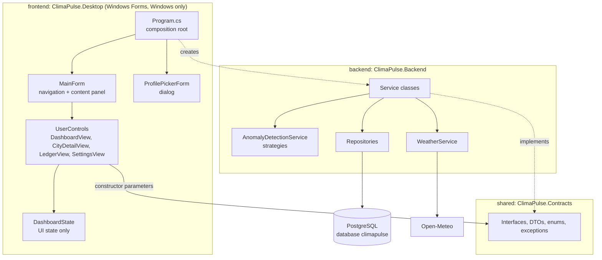

# ClimaPulse: Desktop Architecture and References

Status: draft for team review. Last updated 2026-11-16. The UI is Windows Forms (Blazor Hybrid and WPF were dropped on 2026-11-16). Replaces `references-web-and-api.md` (the web and HTTP API design).

This file explains how ClimaPulse is built as a desktop app, how to set up the projects, and where to read more. The database schema (`backend/Database/schema.sql`) and the repositories are already done. The contract between frontend and backend is in `docs/api-contract.md`.

**Link status.** *Verified* means the page was opened or appeared in a live web search on the date shown. *Check* means it is a well-known official page I could not confirm from my environment, so open it once before relying on it.

---

## 1. Decisions

| Topic | Decision | Decided by |
|---|---|---|
| Platform | Windows desktop app, required by Module 1 ("C# desktop application: Windows Store, Windows Forms or WPF") | Module 1 |
| UI technology | Windows Forms. The main window is a `Form`, screens are `UserControl`s, dialogs are small `Form`s. No Blazor, no Razor, no WPF | Nalen (project manager), 2026-11-16 |
| Frontend to backend | In-process C# interfaces in `shared/ClimaPulse.Contracts`. No HTTP API | Radit, 2026-10-22 |
| Users | No login. Profile picker on start | Radit, 2026-10-22 |
| Framework | .NET 10 LTS | Radit, 2026-10-16 |
| Database | PostgreSQL through `Npgsql`, existing ADO.NET repositories | Modul 4, changed 2026-11-16 |
| Repo layout | Monorepo: `frontend/`, `backend/`, `shared/` | Radit |
| Weather data | Open-Meteo forecast and archive APIs | PRD |
| Team machines | Everyone develops on Windows | Radit, 2026-10-22 |

### Why these choices, and what they cost

**A. Windows Forms**
- Pros: allowed by Module 1 and by the team. Drag-and-drop designer in Visual Studio, so screens are quick to build. Built-in `DataGridView`, `SaveFileDialog`, `.resx` localization and keyboard focus handling. No WebView2 runtime needed.
- Cons: looks plainer than a web UI, so colours and spacing need care. No built-in chart control on .NET 10 (see 1E). Layout on high-DPI screens needs testing.

**B. In-process services instead of an HTTP API**
- Pros: one program, one F5, nothing to start first. No ports, CORS or network errors between UI and logic, which protects the "demo runs without errors" grade (20 percent). The contract is checked by the compiler.
- Cons: a future web or mobile client would need an HTTP layer added on top of the same interfaces.

**C. Target frameworks**
- `shared/ClimaPulse.Contracts` and `backend`: `net10.0`. Their unit tests also run on Mac, Linux or a CI server.
- `frontend`: `net10.0-windows` with `<UseWindowsForms>true</UseWindowsForms>`.
- Background: Microsoft's notice says .NET 8 and 9 stop being supported on 2026-11-10, which is why the project uses .NET 10.

**D. Keep the existing ADO.NET repositories**
- Pros: already written. Cons: SQL is hand-written, so a column change touches two places. Revisit Entity Framework Core only if the schema changes a lot.

**E. Charts (SRD OPEN-9)**
- The old `System.Windows.Forms.DataVisualization` chart is .NET Framework only.
- Start with a `DataGridView` for city history. If a chart is needed, pick one library (for example ScottPlot.WinForms or LiveCharts2), try it in a 15-minute spike, and get team approval before adding the package (AGENTS.md).

**F. No dependency injection package**
- `Program.cs` builds the objects by hand and passes interfaces into each form's constructor. For one window and about ten services this is shorter than `Microsoft.Extensions.DependencyInjection` and needs no extra package.

---

## 2. Architecture



Layering rules:
1. Forms and user controls receive only `ClimaPulse.Contracts` interfaces, through their constructors. Never a repository, `WeatherService` or another backend class.
2. Only `frontend/Program.cs` (the composition root) knows the backend classes, to create them.
3. Services return DTOs, never `ClimaPulse.Models` entities.
4. Only `WeatherService` calls Open-Meteo.
5. Tier and z-score logic lives only in the backend. Forms only display it.

Screens (one `UserControl` each, shown inside `MainForm`'s content panel):

| Screen | Controls | SRD |
|---|---|---|
| `ProfilePickerForm` (dialog on start) | `ListBox`, "New profile" button | FR-29 |
| `DashboardView` | `DataGridView` or `FlowLayoutPanel` of city cards, tier badge `Label`s (colour + text), Refresh button, last-updated label | FR-17, FR-18, FR-19 |
| `CityDetailView` | Current value, baseline mean and SD, z-score, history `DataGridView` | FR-20 |
| `WatchlistView` | City search `TextBox` + results, threshold `NumericUpDown`, note `TextBox` | FR-01 to FR-04 |
| `LedgerView` | Filter controls, paged `DataGridView`, Export button with `SaveFileDialog` | FR-26, FR-27 |
| `SettingsView` | Unit and language `ComboBox`es, theme option | FR-05, FR-21 |

---

## 3. Setup guide

Do these on a feature branch. You need Windows, the .NET 10 SDK (`dotnet --version` prints `10.x`), Visual Studio 2022 or newer with the ".NET desktop development" workload (for the Forms designer), and a local PostgreSQL server.

### Step 1: Create the projects

```bash
# from the repo root, on a fresh branch
dotnet new classlib -n ClimaPulse.Contracts -o shared/ClimaPulse.Contracts
dotnet new classlib -n ClimaPulse.Backend   -o backend
dotnet new winforms -n ClimaPulse.Desktop   -o frontend
dotnet new xunit    -n ClimaPulse.Backend.Tests -o tests/ClimaPulse.Backend.Tests
dotnet new sln -n ClimaPulse
dotnet sln add shared/ClimaPulse.Contracts backend frontend tests/ClimaPulse.Backend.Tests
dotnet add backend  reference shared/ClimaPulse.Contracts
dotnet add frontend reference shared/ClimaPulse.Contracts backend
dotnet add tests/ClimaPulse.Backend.Tests reference backend
dotnet add backend  package Npgsql
```

Pitfalls:
- `dotnet new` writes `Class1.cs`, `Form1.cs` and `Program.cs` into folders that already hold code. Check `git status` afterwards. Keep one `Program.cs` in `frontend/` (the template's version, with the composition root from step 3) and delete the generated `Class1.cs` files.
- `frontend/Components/Dashboard.razor` is left over from the Blazor design. Delete it once `DashboardView` exists (a file deletion, so agree on it first, AGENTS.md).
- Move `backend/Enums/*.cs` into `shared/ClimaPulse.Contracts/Enums/`, keeping the namespace `ClimaPulse.Enums`, so the UI can use them without referencing the backend. This is a file move, so agree on it first.
- Each package needs team approval before it is added (AGENTS.md).

### Step 2: The Desktop project file

`frontend/ClimaPulse.Desktop.csproj` (the template already writes most of this):

```xml
<Project Sdk="Microsoft.NET.Sdk">
  <PropertyGroup>
    <OutputType>WinExe</OutputType>
    <TargetFramework>net10.0-windows</TargetFramework>
    <UseWindowsForms>true</UseWindowsForms>
    <Nullable>enable</Nullable>
    <ImplicitUsings>enable</ImplicitUsings>
    <RootNamespace>ClimaPulse.Desktop</RootNamespace>
    <ApplicationHighDpiMode>PerMonitorV2</ApplicationHighDpiMode>
  </PropertyGroup>
  <ItemGroup>
    <Content Include="..\backend\Database\schema.sql" Link="Database\schema.sql" CopyToOutputDirectory="PreserveNewest" />
  </ItemGroup>
</Project>
```

### Step 3: The composition root

`frontend/Program.cs` is the only place where frontend code names backend classes:

```csharp
using ClimaPulse.Contracts;
using ClimaPulse.Repositories;
using ClimaPulse.Services;

namespace ClimaPulse.Desktop;

internal static class Program
{
    // true while the backend is unfinished: screens use sample data from frontend/Fakes
    private static readonly bool UseFakes = true;

    [STAThread]
    private static void Main()
    {
        ApplicationConfiguration.Initialize();   // DPI, visual styles, default font
        Application.ThreadException += (_, e) => ShowError(e.Exception);
        AppDomain.CurrentDomain.UnhandledException += (_, e) => ShowError((Exception)e.ExceptionObject);

        IDashboardService dashboard;
        // ... one variable per interface

        if (UseFakes)
        {
            dashboard = new FakeDashboardService();
        }
        else
        {
            var connectionString = DatabaseConfig.ConnectionString;
            DatabaseInitializer.EnsureCreated(connectionString,
                Path.Combine(AppContext.BaseDirectory, "Database", "schema.sql"));

            // Repositories are stateless and open a connection per call, so one instance is enough.
            var cities = new CityRepository(connectionString);
            // ... the other six repositories

            // Open-Meteo: one shared HttpClient with a timeout, plus the two addresses.
            var http = new HttpClient { Timeout = TimeSpan.FromSeconds(20) };
            var weather = new WeatherService(http, new OpenMeteoOptions());

            dashboard = new DashboardService(/* repositories, weather */);
            // ... one service per interface
        }

        var state = new DashboardState();   // current profile, last results
        Application.Run(new MainForm(state, dashboard /* , other interfaces */));
    }

    private static void ShowError(Exception ex)
    {
        // Log ex to a file for the developer; show a short message without stack traces.
        MessageBox.Show("Something went wrong. Please try again.", "ClimaPulse",
            MessageBoxButtons.OK, MessageBoxIcon.Error);
    }
}
```

Why each piece exists:
- `ApplicationConfiguration.Initialize()` is generated by the template and turns on high-DPI support and visual styles.
- The two exception handlers keep one unexpected bug from closing the app during the demo (contract section 7).
- `UseFakes` lets the frontend developer build every screen before the backend is ready (contract section 10).
- `EnsureCreated` creates the tables on a new PC; the `Content` item in step 2 copies `schema.sql` next to the `.exe`.
- A single shared `HttpClient` is the simple, correct choice for one desktop process.
- Forms get their services through constructors, so the Forms designer still works as long as each form also keeps the designer's `InitializeComponent()` call.

### Step 4: Calling services from a form

```csharp
private async void RefreshButton_Click(object? sender, EventArgs e)
{
    refreshButton.Enabled = false;
    try
    {
        var result = await _dashboard.GetAsync(_state.ProfileId);
        ShowCities(result);
    }
    catch (ClimaPulseException ex)
    {
        MessageBox.Show(ex.Message, "ClimaPulse", MessageBoxButtons.OK, MessageBoxIcon.Warning);
    }
    finally
    {
        refreshButton.Enabled = true;
    }
}
```

- `async void` is correct only for event handlers. `await` returns to the UI thread, so controls can be updated directly afterwards.
- Never call `.Result` or `.Wait()` in a form; it freezes or deadlocks the window.
- For progress (baseline refresh), pass a `Progress<int>` created on the UI thread and set a `ProgressBar` in its callback.

### Step 5: Database and configuration

- Install PostgreSQL on the PC and create the database once with `createdb climapulse`. `DatabaseConfig` reads the connection string from `CLIMAPULSE_DB_CONNECTION` and falls back to `Host=localhost;Port=5432;Database=climapulse;Username=postgres`. `DatabaseInitializer` creates the tables on first start.
- .NET does not read `.env` files. `backend/.env.example` only documents the variable names. Set the variable in the Visual Studio launch profile or in Windows environment variables.
- Settings that are not in the database (last profile, theme) go in `%LOCALAPPDATA%\ClimaPulse\settings.json` (contract decision C3).

### Step 6: Test

- Unit tests (xUnit): `AnomalyDetectionService`, strategies, z-score and tier rules. No database, no network.
- Service tests: each interface method against a separate test PostgreSQL database, checking DTO values and exception types.
- Manual demo path: pick profile, add city, refresh, see badge, open city detail, open ledger, export CSV. Run it on the demo laptop, not only on the developer's PC, and at 125 or 150 percent display scaling.

### Step 7: Publish a demo build

```bash
dotnet publish frontend -c Release -r win-x64 --self-contained true -o publish/ClimaPulse
```

Zip the `publish/ClimaPulse` folder and attach it to a GitHub Release. Module 1 grades "access information for a product demo", so link that release from the README together with short run instructions, including the PostgreSQL install and `createdb climapulse` step. A self-contained build runs on a PC without the .NET SDK.

---

## 4. Reference links

### Desktop and Windows Forms

| Topic | Link | Status |
|---|---|---|
| Windows Forms documentation home | https://learn.microsoft.com/dotnet/desktop/winforms/ | Check |
| Create a Windows Forms app with Visual Studio | https://learn.microsoft.com/dotnet/desktop/winforms/get-started/create-app-visual-studio | Check |
| High DPI support in Windows Forms | https://learn.microsoft.com/dotnet/desktop/winforms/high-dpi-support-in-windows-forms | Check |
| `DataGridView` control | https://learn.microsoft.com/dotnet/desktop/winforms/controls/datagridview-control-windows-forms | Check |
| Localizing Windows Forms (`.resx`) | https://learn.microsoft.com/dotnet/desktop/winforms/advanced/globalizing-windows-forms | Check |
| .NET application publishing overview | https://learn.microsoft.com/dotnet/core/deploying/ | Verified 2026-10-22 |
| Single-file deployment | https://learn.microsoft.com/dotnet/core/deploying/single-file/overview | Verified 2026-10-22 |
| .NET 8 and 9 end of support notice | https://devblogs.microsoft.com/dotnet/dotnet-8-9-end-of-support/ | Verified 2026-10-16 |

### Database

| Topic | Link | Status |
|---|---|---|
| Npgsql documentation | https://www.npgsql.org/doc/ | Check |
| Npgsql on NuGet | https://www.nuget.org/packages/Npgsql | Check |

### Weather data

| Topic | Link | Status |
|---|---|---|
| Open-Meteo forecast API docs | https://open-meteo.com/en/docs | Verified 2026-10-22 (opened) |
| Open-Meteo historical (archive) API docs | https://open-meteo.com/en/docs/historical-weather-api | Verified 2026-10-22 (opened) |
| Open-Meteo geocoding API (city search, contract decision C2) | https://open-meteo.com/en/docs/geocoding-api | Verified 2026-10-22 (opened) |
| Open-Meteo terms | https://open-meteo.com/en/terms | Verified 2026-10-22 (opened) |

Confirmed on those pages on 2026-10-22: free use is non-commercial, under CC BY 4.0, limited to less than 600 calls per minute, 5,000 per hour, 10,000 per day and 300,000 per month per IP address. ERA5 and ERA5-Land archive data has about a 5-day delay. The endpoints, variables and units the backend uses are fixed in `docs/api-contract.md`, section 14. Cache every archive response in `HistoricalObservation` so a city is never downloaded twice.

### Charts (only if SRD OPEN-9 decides for one)

| Topic | Link | Status |
|---|---|---|
| ScottPlot (has a WinForms control) | https://scottplot.net/ | Check |
| LiveCharts2 (has a WinForms control) | https://livecharts.dev/ | Check |

---

## 5. Known pitfalls

1. **Time zones.** The database stores UTC (`yyyy-MM-ddTHH:mm:ssZ`). Convert to the city's `timezone` only in the UI.
2. **Decimal separator.** Indonesian Windows writes `29,1`. Use `CultureInfo.InvariantCulture` for export files and for any number sent to Open-Meteo in a URL. Reading coordinates with the wrong culture silently sends a wrong place.
3. **Frozen window.** Forms run on the UI thread. `await` every service call in `async void` event handlers. Long database or calculation work goes into `Task.Run` in the backend. Never call `.Result` or `.Wait()` in a form.
4. **Cross-thread control access.** Only touch controls from the UI thread. After `await` you are back on it; inside `Task.Run` you are not, so report through `IProgress<T>` instead.
5. **Month baselines.** One row per city, metric and calendar month, computed from about 30 years of data. Compute once, store, refresh with the existing upsert, and show progress.
6. **Duplicate ledger rows.** Open one `AnomalyEvent` when a reading crosses the threshold, keep it `active`, close it when readings return below the closing threshold (hysteresis, SRD OPEN-1).
7. **Snapshots.** Copy the baseline mean and standard deviation into the event when it opens. Never join back to `Baseline` to show an old event.
8. **Zero standard deviation.** `stddev_value` may be 0. Return `DataStatus.ZeroVariance` instead of dividing.
9. **Overlapping refreshes.** Do not run a baseline refresh and a live refresh for the same city at the same time. The contract makes the second call throw `ConflictException`. Disable the button while a call runs.
10. **Database server.** The app needs a running PostgreSQL server. Check it is installed and started on the demo laptop, and show a clear error when the connection fails.
11. **Designer files.** Do not hand-edit `*.Designer.cs`; change the form in the Visual Studio designer. Two people editing the same form at once causes painful merge conflicts, so give each screen one owner.

---

## 6. Suggested build order

1. Create the solution and projects. `MainForm` opens with an empty navigation panel.
2. Contracts project: enums (moved), DTOs, interfaces, exceptions (copy from `docs/api-contract.md`).
3. Frontend: fakes for every interface, then `ProfilePickerForm` and `DashboardView` against the fakes.
4. Backend in parallel: `IProfileService`, `ICityService`, `IWatchlistService` on the existing repositories, with service tests.
5. `WeatherService` live fetch, then archive fetch and `IBaselineService`.
6. `AnomalyDetectionService`, the temperature strategy, event logging, `IMonitoringService` and `IDashboardService`.
7. Switch `UseFakes` off. `LedgerView` with CSV and JSON export.
8. Publish the demo build and run the demo path on the demo laptop.
9. Precipitation and wind strategies, twin cities and impact estimates if time remains.

Requirements and open decisions are in `docs/SRD.md`. The contract is in `docs/api-contract.md`.
