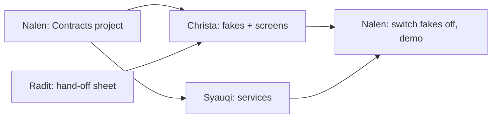

# ClimaPulse: Team Tasks

Last updated 2026-11-25. Owner of this file: Nalen (PM). Tick a box in your own PR when the task is merged.

Sources: `docs/SRD.md` (0.4.4), `docs/api-contract.md`, `docs/references-desktop-architecture.md`, Figma file "Junpro" (Set A, the sidebar design, is final).

| Person | Role |
|---|---|
| Nalen | Software engineer and project manager |
| Radit | UI/UX designer |
| Christa | Frontend developer (WPF) |
| Syauqi | Backend developer (services, Open-Meteo, PostgreSQL) |

---

## How we work

- One task per branch, named `type/short-description` (for example `feat/dashboard-view`). Never commit to `main`.
- Open a PR into `Development`. One teammate reviews, then a human merges. `Development` goes into `main` before each demo.
- Run `dotnet build` and `dotnet test` before every PR. Both must pass.
- Frontend code uses only the interfaces in `shared/ClimaPulse.Contracts`. Only `frontend/App.xaml.cs` creates backend classes. The UI is WPF (SRD 1.3, accepted 2026-11-25).
- English only in v1. All screen text goes in `.resx` files.
- Charts are drawn by hand with `Graphics`. No chart library. Ask Nalen before adding any package.

## Order of work

Nalen's Contracts project blocks both Christa and Syauqi, so it comes first. Christa builds every screen against fake services, so she does not wait for the backend.

---

## Nalen: software engineer and PM

### Week 1: unblock the team
- [x] Push and merge the local branches into `Development`, in order: `feat/modul9-oop`, `docs/charts-by-hand`, `fix/english-locale`, `docs/team-tasks`
- [x] Create `shared/ClimaPulse.Contracts`: the 8 interfaces, all DTOs, enums and the 5 exception types from `docs/api-contract.md` (#10, built by Syauqi)
- [x] Move `backend/Enums/*.cs` into the Contracts project (namespace stays `ClimaPulse.Enums`) (#10)
- [x] Add Contracts to `ClimaPulse.slnx` (#10)
- [x] WPF project `frontend/ClimaPulse.Desktop` in `ClimaPulse.slnx` (Christa, `feat/fe`, not merged yet)
- [ ] Review `frontend/App.xaml.cs` (composition root): all 8 services, one `CityRefreshState` shared by baseline, monitoring and dashboard, and the `DispatcherUnhandledException` crash handler (architecture guide, step 3)
- [ ] Start-up check: call `DatabaseInitializer` in `App.xaml.cs` and show Radit's S1 "database not reachable" screen with Retry when it fails (SRD OPEN-10)
- [x] Delete the leftover `frontend/Components/Dashboard.razor` (done 2026-11-21, no Blazor left in the repo)

### Decisions to close
- [x] OPEN-1: tiers Watch 2.0, Warning 3.0, Extreme 4.0; events close below 1.75 (#9)
- [x] OPEN-10: backend details (in-memory last refresh, health advisory on events, n - 1 standard deviation, zero variance, duplicate cities, `is_active` unused) and contract C2 (#9)
- [ ] OPEN-4: demo starts from `seed.sql` plus pre-downloaded baselines
- [ ] OPEN-5: refresh only on button press, or also a timer
- [ ] OPEN-8: confirm with the teaching assistant that a group of four is accepted
- [ ] Decide with Radit and Christa which Figma effects stay simple in WPF (skeleton loaders, drawer, rounded cards)

### Ongoing
- [ ] Review every PR that touches `shared/ClimaPulse.Contracts`
- [ ] Weekly module tasks (Modul 9 OOP evidence is done: polymorphism through `IAnomalyStrategy`, its 4 tests still pass)
- [ ] Update `docs/project-checklist.md` and the SRD "known gaps" paragraph: `AnalyzeCityAsync` is replaced by `IMonitoringService.RefreshCityAsync` (#17), and Contracts and the services now exist
- [ ] Keep `docs/SRD.md` and this file up to date

### Before the demo
- [ ] Install PostgreSQL on the demo laptop and run `createdb climapulse` (the database tests also need `createdb climapulse_test` and `CLIMAPULSE_TEST_DB_CONNECTION`)
- [ ] Switch `UseFakes` off and run the demo path: pick profile, add city, refresh, see badge, open city detail, open ledger, export CSV
- [ ] Pre-download baselines for the demo cities, so the demo does not wait on Open-Meteo (OPEN-4)
- [ ] Try the ledger export on Windows set to Indonesian regional settings (tests already check the `id-ID` culture)
- [ ] Self-contained publish, zip, GitHub Release, run instructions in the README (NFR-16)
- [ ] GitHub Page from `docs` on `main` (Module 1)

---

## Radit: UI/UX

The six main screens and most of their states are done in Figma (Set A). What is left:

### Design
- [ ] S1: "database not reachable" screen at start-up (PostgreSQL not running). Message, what to check, and a Retry button
- [ ] S6: remove the Theme field, or keep it with Dark disabled (dark theme is out of v1, FR-21)
- [ ] `Components` page: change the note "Blazor: inline SVG or an icon font" to WPF
- [ ] Move the `cld ·` pages (Set B) into `Archive` so nobody builds from them
- [ ] S8 GitHub Page: one page with the product idea, screenshots, team and the demo download link

### Hand-off to Christa
- [ ] One hand-off frame or page with exact values: colours (hex), font sizes and weights (Segoe UI or Inter), spacing, corner radius, badge colours per tier
- [ ] Export the 8 utility icons and 4 tier icons as 16 px PNG (and 32 px for high DPI)
- [ ] List of all screen text in English (button labels, messages, empty and error states) for the `.resx` files
- [ ] Check every tier badge with a colour-blindness simulator and the contrast rules (NFR-11)

---

## Christa: frontend (WPF)

### To finish `feat/fe` (found in review, 2026-11-25)
- [ ] Wire the 4 missing services in `App.xaml.cs`: `IDashboardService`, `IMonitoringService`, `IBaselineService`, `IAdvisoryService` (with `TemperatureStrategy`, `PrecipitationStrategy`, `WindStrategy` and one shared `CityRefreshState`)
- [ ] Dashboard: show tiers from `IDashboardService.GetAsync`, and make Refresh all call `IMonitoringService.RefreshCityAsync` per city
- [ ] City detail: replace the sample values (36.9 °C, z +4.3 and the "Sample … preview" texts) with real readings, baselines and advice
- [ ] Add a `DispatcherUnhandledException` handler so a bug in a screen does not close the app (contract section 7)
- [ ] Add `<EnableWindowsTargeting>true</EnableWindowsTargeting>` to `ClimaPulse.Desktop.csproj` so CI (Linux) can build it
- [ ] Update `feat/fe` from `Development` and open a PR (the `AGENTS.md` edit is no longer needed)

Build in this order. Use the fakes until Syauqi's services are ready.

### Foundation
- [ ] `frontend/Fakes/`: one fake class per interface, with Surabaya, Jakarta, Yogyakarta, Tokyo sample data
- [ ] `Theme` class: colours, fonts and spacing from Radit's hand-off
- [ ] `MainWindow`: sidebar (Dashboard, Anomaly Ledger, Settings, profile chip) and a content area that swaps user controls
- [ ] One shared helper that catches `ClimaPulseException` and shows the message (contract section 7)

### Reusable controls
- [ ] `TierBadge` (Normal, Watch, Warning, Extreme: colour, icon and text)
- [ ] `CityCard` (Normal, Watch, Warning, Extreme, No baseline, Error)
- [ ] `FilterChip`, `Banner` (Info, Error), `StateMessage` (Empty, Loading, Error)
- [ ] `BellCurveChart` and `TrendChart` drawn in `OnPaint` (temperature line and rain bars), `DoubleBuffered = true`

### Screens (Figma Set A)
- [ ] S1 `ProfilePickerWindow`: main and first run (FR-29)
- [ ] S2 Add city dialog: search, results, already added, searching, no results, Open-Meteo error, importing 30 years with progress (FR-01, FR-02, FR-07)
- [ ] S3 `DashboardView`: city grid, metric filter, Refresh all, loading, empty, Open-Meteo down (FR-17, FR-18)
- [ ] S4 `CityDetailView`: Temperature and Rain tabs, both charts, advice, alert threshold, past events, remove-city confirm, loading, baseline not ready, error (FR-03, FR-04, FR-19, FR-20)
- [ ] S5 `LedgerView`: filters, paged `DataGrid`, event details, Export CSV and JSON with `SaveFileDialog`, export saved and failed banners, loading, empty, error (FR-26, FR-27)
- [ ] S6 `SettingsView`: unit, default threshold, profile name, refresh baselines with progress, saved and invalid input states (FR-04, FR-05, FR-09)
- [ ] Settings file `%LOCALAPPDATA%\ClimaPulse\settings.json` for the last profile (contract C3)

### Rules
- [ ] Every event handler is `async void` and `await`s the service. No `.Result` or `.Wait()`
- [ ] Window works from 1024 x 640 up to full HD, and at 125 and 150 percent display scaling (UI-1)
- [ ] Replace `frontend/State/DashboardState.cs` entities with DTOs

---

## Syauqi: backend

All 8 contract services are written. #16 to #19 are open: merge them in order.

### Repositories
- [x] Ledger paging and counting in SQL, peak updates that never lower the tier, event by id (FR-23, FR-26) (#11)
- [x] Duplicate-city lookup by Open-Meteo id or rounded coordinates (OPEN-10) (#11)

### Open-Meteo (`WeatherService`, the only class that calls it)
- [x] `FetchTodayAsync` (was `FetchLiveAsync`): today's daily temperature and rain in the city's time zone (FR-06) (#12)
- [x] `FetchArchiveAsync`: 1995 to 2024 daily history; `IBaselineService` stores it (FR-07) (#12)
- [x] City search through the geocoding API (FR-01, contract C2) (#12)
- [x] Timeouts, HTTP errors, rate limits and unreadable answers become `UpstreamException` with the city id. Numbers in URLs use `CultureInfo.InvariantCulture` (#12)
- [ ] Log the reason of an HTTP 400 once the backend has a log file (marked `shortcut:` in `WeatherService`)

### Anomaly logic
- [ ] Hysteresis: `AnomalyDetectionService.DecideEvent` opens at 2.0, closes below 1.75, reopens on a sign flip (FR-22 to FR-25). `AnalyzeCityAsync` is removed (PR #17 open)
- [ ] Monthly baselines from the stored history: mean, sample standard deviation, sample size, with progress (FR-08, FR-09) (PR #16 open)
- [ ] `WindStrategy` only if time remains (FR-14, Could). Wind is not scored in v1

### Services behind the contract (all return DTOs, never models)
- [x] `IProfileService`, `IWatchlistService` (#13)
- [x] `ICityService`, `IAdvisoryService` (#14)
- [x] `IEventLedgerService`: filter, page, export CSV and JSON with invariant numbers (FR-26, FR-27) (#15)
- [ ] `IBaselineService` (PR #16 open)
- [ ] `IMonitoringService` (PR #17 open)
- [ ] `IDashboardService` (PR #18 open)
- [x] Database not reachable: decided as a start-up check in `App.xaml.cs` (see Nalen's list), no contract change

### Tests
- [ ] Unit tests for hysteresis (PR #19 open) and for baseline maths (PR #16 open) (NFR-13)
- [x] Service tests against `climapulse_test`, marked `Category=Database`. Run the rest with `dotnet test --filter Category!=Database` (#11 to #15)

---

## Done so far

- Database schema and seed (PostgreSQL), 8 models, 7 repositories
- `ZScoreCalculator`, `TemperatureStrategy`, `PrecipitationStrategy`, `AssignTier`, `AnomalyDetectionService.Evaluate`
- `AdvisoryService` reading advisories from the database, English (`en-US`) defaults
- `shared/ClimaPulse.Contracts` and the Profile, Watchlist, City, Advisory and Event Ledger services (#10 to #15)
- In `Development`: 35 unit tests and 28 database tests pass, build has no warnings. With #16 to #19: 51 and 38
- SRD 0.4.4 with OPEN-1 and OPEN-10 decided, API contract v2.2, architecture guide, design references, class diagrams (diagrams not yet updated for the services)
- Figma Set A: S1 to S6 with loading, empty, error and the extra states added on 2026-11-21
