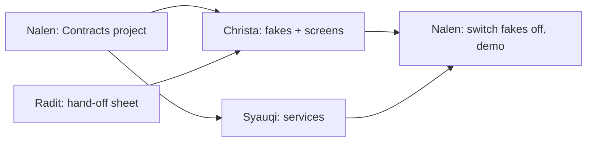

# ClimaPulse: Team Tasks

Last updated 2026-11-21. Owner of this file: Nalen (PM). Tick a box in your own PR when the task is merged.

Sources: `docs/SRD.md` (0.4.3), `docs/api-contract.md`, `docs/references-desktop-architecture.md`, Figma file "Junpro" (Set A, the sidebar design, is final).

| Person | Role |
|---|---|
| Nalen | Software engineer and project manager |
| Radit | UI/UX designer |
| Christa | Frontend developer (Windows Forms) |
| Syauqi | Backend developer (services, Open-Meteo, PostgreSQL) |

---

## How we work

- One task per branch, named `type/short-description` (for example `feat/dashboard-view`). Never commit to `main`.
- Open a PR into `Development`. One teammate reviews, then a human merges. `Development` goes into `main` before each demo.
- Run `dotnet build` and `dotnet test` before every PR. Both must pass.
- Frontend code uses only the interfaces in `shared/ClimaPulse.Contracts`. Only `frontend/Program.cs` creates backend classes.
- English only in v1. All screen text goes in `.resx` files.
- Charts are drawn by hand with `Graphics`. No chart library. Ask Nalen before adding any package.

## Order of work

Nalen's Contracts project blocks both Christa and Syauqi, so it comes first. Christa builds every screen against fake services, so she does not wait for the backend.

---

## Nalen: software engineer and PM

### Week 1: unblock the team
- [ ] Push and merge the local branches into `Development`, in order: `feat/modul9-oop`, `docs/charts-by-hand`, `fix/english-locale`, `docs/team-tasks`
- [ ] Create `shared/ClimaPulse.Contracts`: the 8 interfaces, all DTOs, enums and the 5 exception types from `docs/api-contract.md`
- [ ] Move `backend/Enums/*.cs` into the Contracts project (namespace stays `ClimaPulse.Enums`)
- [ ] Add Contracts and the empty Windows Forms project `frontend/ClimaPulse.Desktop` to `ClimaPulse.slnx`
- [ ] `frontend/Program.cs`: composition root with the `UseFakes` switch and the two crash handlers (architecture guide, step 3)
- [x] Delete the leftover `frontend/Components/Dashboard.razor` (done 2026-11-21, no Blazor left in the repo)

### Decisions to close
- [ ] OPEN-1: tier thresholds (proposed Watch 2.0, Warning 3.0, Extreme 4.0) and the hysteresis margin (proposed 0.25). Syauqi needs this before the ledger logic
- [ ] OPEN-4: demo starts from `seed.sql` plus pre-downloaded baselines
- [ ] OPEN-5: refresh only on button press, or also a timer
- [ ] OPEN-8: confirm with the teaching assistant that a group of four is accepted
- [ ] Decide with Radit and Christa which Figma effects stay simple in Windows Forms (skeleton loaders, drawer, rounded cards)

### Ongoing
- [ ] Review every PR that touches `shared/ClimaPulse.Contracts`
- [ ] Weekly module tasks (Modul 9 OOP evidence is done: polymorphism through `IAnomalyStrategy`, 4 passing tests)
- [ ] Keep `docs/SRD.md` and this file up to date

### Before the demo
- [ ] Install PostgreSQL on the demo laptop and run `createdb climapulse`
- [ ] Switch `UseFakes` off and run the demo path: pick profile, add city, refresh, see badge, open city detail, open ledger, export CSV
- [ ] Self-contained publish, zip, GitHub Release, run instructions in the README (NFR-16)
- [ ] GitHub Page from `docs` on `main` (Module 1)

---

## Radit: UI/UX

The six main screens and most of their states are done in Figma (Set A). What is left:

### Design
- [ ] S1: "database not reachable" screen at start-up (PostgreSQL not running). Message, what to check, and a Retry button
- [ ] S6: remove the Theme field, or keep it with Dark disabled (dark theme is out of v1, FR-21)
- [ ] `Components` page: change the note "Blazor: inline SVG or an icon font" to Windows Forms
- [ ] Move the `cld ·` pages (Set B) into `Archive` so nobody builds from them
- [ ] S8 GitHub Page: one page with the product idea, screenshots, team and the demo download link

### Hand-off to Christa
- [ ] One hand-off frame or page with exact values: colours (hex), font sizes and weights (Segoe UI or Inter), spacing, corner radius, badge colours per tier
- [ ] Export the 8 utility icons and 4 tier icons as 16 px PNG (and 32 px for high DPI)
- [ ] List of all screen text in English (button labels, messages, empty and error states) for the `.resx` files
- [ ] Check every tier badge with a colour-blindness simulator and the contrast rules (NFR-11)

---

## Christa: frontend (Windows Forms)

Build in this order. Use the fakes until Syauqi's services are ready.

### Foundation
- [ ] `frontend/Fakes/`: one fake class per interface, with Surabaya, Jakarta, Yogyakarta, Tokyo sample data
- [ ] `Theme` class: colours, fonts and spacing from Radit's hand-off
- [ ] `MainForm`: sidebar (Dashboard, Anomaly Ledger, Settings, profile chip) and a content panel that swaps user controls
- [ ] One shared helper that catches `ClimaPulseException` and shows the message (contract section 7)

### Reusable controls
- [ ] `TierBadge` (Normal, Watch, Warning, Extreme: colour, icon and text)
- [ ] `CityCard` (Normal, Watch, Warning, Extreme, No baseline, Error)
- [ ] `FilterChip`, `Banner` (Info, Error), `StateMessage` (Empty, Loading, Error)
- [ ] `BellCurveChart` and `TrendChart` drawn in `OnPaint` (temperature line and rain bars), `DoubleBuffered = true`

### Screens (Figma Set A)
- [ ] S1 `ProfilePickerForm`: main and first run (FR-29)
- [ ] S2 Add city dialog: search, results, already added, searching, no results, Open-Meteo error, importing 30 years with progress (FR-01, FR-02, FR-07)
- [ ] S3 `DashboardView`: city grid, metric filter, Refresh all, loading, empty, Open-Meteo down (FR-17, FR-18)
- [ ] S4 `CityDetailView`: Temperature and Rain tabs, both charts, advice, alert threshold, past events, remove-city confirm, loading, baseline not ready, error (FR-03, FR-04, FR-19, FR-20)
- [ ] S5 `LedgerView`: filters, paged `DataGridView`, event details, Export CSV and JSON with `SaveFileDialog`, export saved and failed banners, loading, empty, error (FR-26, FR-27)
- [ ] S6 `SettingsView`: unit, default threshold, profile name, refresh baselines with progress, saved and invalid input states (FR-04, FR-05, FR-09)
- [ ] Settings file `%LOCALAPPDATA%\ClimaPulse\settings.json` for the last profile (contract C3)

### Rules
- [ ] Every event handler is `async void` and `await`s the service. No `.Result` or `.Wait()`
- [ ] Window works from 1024 x 640 up to full HD, and at 125 and 150 percent display scaling (UI-1)
- [ ] Replace `frontend/State/DashboardState.cs` entities with DTOs

---

## Syauqi: backend

The database, repositories, strategies, z-score, tiers and `AdvisoryService` are done. What is left:

### Open-Meteo (`WeatherService`, the only class that calls it)
- [ ] `FetchLiveAsync`: today's daily values for temperature, rain and wind (FR-06)
- [ ] `FetchArchiveAsync`: 30 years of daily history, saved with `HistoricalObservationRepository.AddRange` (FR-07)
- [ ] City search through the geocoding API (FR-01, contract C2)
- [ ] Timeouts, empty answers and rate limits become `UpstreamException` with the city id. Numbers in URLs use `CultureInfo.InvariantCulture`

### Anomaly logic
- [ ] `AnalyzeCityAsync`: evaluate each metric, then open, update or close `AnomalyEvent` rows with hysteresis (FR-22 to FR-25). Wait for OPEN-1
- [ ] Monthly baselines from the stored history: mean, standard deviation, sample size, with progress (FR-08, FR-09)
- [ ] `WindStrategy` only if time remains (FR-14, Could)

### Services behind the contract (all return DTOs, never models)
- [ ] `IProfileService`, `ICityService`, `IWatchlistService`
- [ ] `IDashboardService`, `IMonitoringService`, `IBaselineService`
- [ ] `IAdvisoryService` (wraps the existing `AdvisoryService`)
- [ ] `IEventLedgerService`: filter, page, export CSV and JSON with invariant numbers (FR-26, FR-27)
- [ ] Database not reachable becomes a clear error the UI can show (matches Radit's new S1 screen)

### Tests
- [ ] Unit tests for hysteresis and for baseline maths (NFR-13)
- [ ] Service tests against a separate test database (`climapulse_test`)

---

## Done so far

- Database schema and seed (PostgreSQL), 8 models, 7 repositories
- `ZScoreCalculator`, `TemperatureStrategy`, `PrecipitationStrategy`, `AssignTier`, `AnomalyDetectionService.Evaluate`
- `AdvisoryService` reading advisories from the database, English (`en-US`) defaults
- Backend and test projects build; 4 unit tests pass
- SRD 0.4.3, API contract, architecture guide, design references, class diagrams
- Figma Set A: S1 to S6 with loading, empty, error and the extra states added on 2026-11-21
